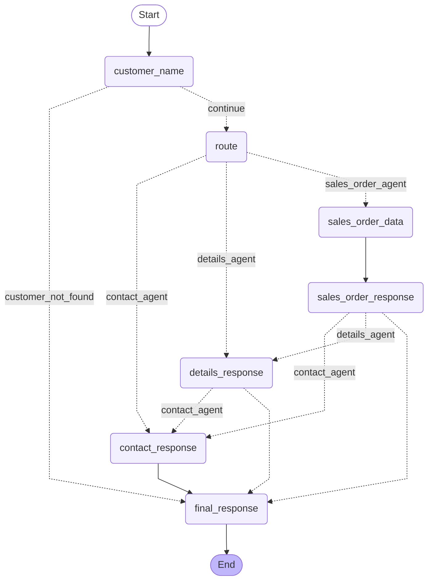

# AI ERPNext Business Assistant

An AI-powered assistant that connects to ERPNext to retrieve customer information, contact details, and sales orders using natural language queries.

The project demonstrates progressively more capable AI application patterns using **LangGraph, local LLMs, and ERPNext REST APIs**.

## Project Overview

The project includes three workflow implementations:

- **Reflection:** Analyzes retrieved sales order data and reviews the generated analysis.
- **Reflexion:** Uses feedback, lessons, and iterative retries to improve an analysis.
- **Multi-Agent System:** Routes user queries to specialized agents to retrieve customer details, contact information, and sales orders.

The application uses Ollama to run a local language model and Gradio to provide an interactive interface with workflow progress updates.

## Features

- Natural language queries for ERPNext customer and sales order data.
- Reflection and Reflexion workflows.
- Supervisor-based Multi-Agent routing using LangGraph.
- Specialized Customer Details, Customer Contact, and Sales Order agents.
- Support for individual and combined information requests.
- Customer verification before processing requests.
- Sales order status extraction and validation.
- Handling of missing customer and contact information.
- ERPNext API error handling.
- Gradio workflow progress updates using LangGraph streaming.
- Local LLM execution using Ollama.
- LangSmith tracing for workflow observability.
- Automated tests using pytest.


## Application Screenshots

The following screenshots demonstrate the application interface, workflow execution, and Multi-Agent responses.

### 1. Application Interface


### 2. Reflection Workflow


### 3. Reflexion Workflow


### 4. Multi-Agent Workflow


### 5. Sales Order Results and Error Handling


## Example Queries

- Show me Sandeep's customer details.
- Get Sandeep's contact information.
- Show me Sandeep's sales orders.
- Show me Sandeep's completed sales orders.
- Show me Sandeep's customer details and contact information.
- Show me Sandeep's customer details and sales orders.
- Show me Sandeep's contact information and sales orders.
- Show me all information for Sandeep.

## Architecture

The application uses separate LangGraph workflows to demonstrate Reflection, Reflexion, and Multi-Agent processing.

### 1. Reflection Workflow

The Reflection workflow retrieves sales orders for a customer, analyzes the results, and reviews the generated analysis.

Main flow:

1. Retrieve sales orders from ERPNext.
2. Analyze the retrieved data.
3. Review the generated analysis.
4. Return the response.

The goal is to review the quality and completeness of an answer before returning it.

### 2. Reflexion Workflow

The Reflexion workflow extends Reflection by introducing feedback, lessons, and retries.

Main flow:

1. Retrieve sales order data.
2. Generate an analysis.
3. Evaluate the analysis.
4. Generate feedback when improvements are required.
5. Extract a lesson from the previous attempt.
6. Retry the analysis using feedback and previous-attempt information.
7. Stop when the response is approved or the maximum iteration limit is reached.

This workflow demonstrates how shared state, conditional edges, and iterative execution can be used to improve an answer.

### 3. Multi-Agent Workflow

The Multi-Agent workflow interprets the user's request, verifies the customer, and routes the request to the appropriate processing path.

It supports individual requests and combined requests involving customer details, contact information, and sales orders.

#### Workflow Diagram



#### Multi-Agent Workflow Steps

1. **Customer Name Extraction:** Extract the customer name from the user's query.
2. **Customer Verification:** Check whether the customer exists before continuing.
3. **Supervisor Routing:** Select the appropriate route based on the requested information.
4. **Agent Execution:** Retrieve customer details, contact information, sales orders, or a combination of these.
5. **Conditional Routing:** Continue to another agent when a combined query requires additional information.
6. **Final Response:** Prepare the response for the user based on the retrieved information and any relevant errors.

Supported routing combinations:

- Customer details
- Contact information
- Sales orders
- Customer details and contact information
- Customer details and sales orders
- Contact information and sales orders
- Customer details, contact information, and sales orders


#### Workflow Components

The Multi-Agent workflow uses a shared state to pass information between workflow nodes and specialized agents. It stores the user query, customer information, routing decisions, sales order results, API error information, and the final response.

**Shared Workflow State**

The workflow state includes fields such as:

- `user_query`: Original user query.
- `customer_name`: Extracted customer name.
- `customer_found`: Indicates whether the customer was found.
- `customer_details`: Retrieved customer details.
- `customer_contact`: Retrieved contact information.
- `sales_order_data`: Retrieved sales order data.
- `route`: Supervisor routing decision.
- `details_response`: Customer Details Agent response.
- `contact_response`: Customer Contact Agent response.
- `sales_order_response`: Sales Order Agent response.
- `sales_order_error`: Sales-order-specific error information.
- `ERPNextAPIError`: ERPNext API error message stored in the workflow state.
- `final_response`: Final response returned to the user.

The `ERPNextAPIError` exception is defined in `app/erpnext/client.py` and handled by the workflow nodes.
## Specialized Agents

### Customer Supervisor Agent

The supervisor interprets the user's query and determines the appropriate processing path.

It supports requests for customer details, contact information, sales orders, and combinations of these.

### Customer Details Agent

Retrieves customer information from ERPNext, including available fields such as:

- Customer name
- Customer group
- Territory
- Customer type

Unavailable fields are handled without treating missing information as populated data.

### Customer Contact Agent

Retrieves available customer contact information, including:

- Mobile number
- Email address

Missing contact information is reported appropriately.

### Sales Order Agent

Retrieves sales orders for a specified customer and supports filtering by sales order status.

Supported status filters include:

- Draft
- To Deliver
- To Deliver and Bill
- To Bill
- Completed
- Cancelled
- Closed

If no status is specified, the agent retrieves sales orders without applying a status filter.

Unsupported status values are validated rather than being treated as valid ERPNext statuses.

## ERPNext Integration and Error Handling

The application uses ERPNext REST APIs to retrieve customer, contact, and sales order information.

The ERPNext client centralizes API communication and uses environment variables for configuration.

Required environment variables:

```env
ERPNEXT_URL=your_erpnext_url
ERPNEXT_API_KEY=your_api_key
ERPNEXT_API_SECRET=your_api_secret
```

Keep credentials in the local `.env` file and do not commit secrets to version control.

The workflow includes error handling for API failures and sales order processing. Relevant scenarios include:

- Authentication failures
- Permission errors
- Missing customer information
- Missing contact information
- Empty sales order results
- Unsupported sales order status requests

Errors and empty results are handled separately so that an unsuccessful API request is not confused with a successful request that returned no records.

## Gradio Interface and Workflow Streaming

The application provides a Gradio interface for submitting natural language queries.

Workflow progress updates are streamed during execution to make the processing steps visible to the user.

The interface displays progress as the workflow processes the request, retrieves information, and prepares the final response.

## LangSmith Observability

LangSmith is used for tracing and inspecting LangChain and LangGraph execution.

Tracing helps investigate:

- Node execution
- LLM calls
- Intermediate outputs
- Workflow errors
- Information passed between workflow steps

This supports debugging and understanding the application's execution flow.

## Testing

### Automated Tests

Run the test suite from the project root:

```bash
python -m pytest
```

The latest recorded automated test run completed with **2 tests passed**.

Tests confirmed in that run:

- `tests/test_analyzer.py`
- `tests/test_reflexion_debug.py`

### Multi-Agent Validation

Manual validation has covered the supported routing combinations and relevant workflow scenarios, including customer lookup, missing information, sales order status handling, and API error handling.

Manual checks are separate from automated pytest results. Run the relevant scenarios again after code changes to verify the current behavior.

## Technology Stack

| Technology | Purpose |
|---|---|
| Python | Application logic |
| ERPNext REST API | Business data retrieval |
| FastAPI | API development |
| LangChain | LLM integration and prompt management |
| LangGraph | Stateful workflows and conditional routing |
| Ollama | Local LLM execution |
| Qwen2.5 3B | Local language model |
| Gradio | Interactive user interface and workflow progress |
| LangSmith | Tracing and observability |
| pytest | Automated testing |
| Git and GitHub | Version control and project hosting |

## Project Structure

```text
ai-erpnext-assistant/
├── app/
│   ├── agents/
│   │   ├── analyzer.py
│   │   ├── reflector.py
│   │   ├── feedback.py
│   │   ├── lesson.py
│   │   ├── customer_supervisor.py
│   │   ├── customer_details_agent.py
│   │   ├── customer_contact_agent.py
│   │   └── sales_order_agent.py
│   ├── api/
│   │   └── routes.py
│   ├── erpnext/
│   │   ├── client.py
│   │   ├── customer.py
│   │   ├── contact.py
│   │   └── sales_order.py
│   ├── graph/
│   │   ├── edges.py
│   │   ├── nodes.py
│   │   ├── prompts.py
│   │   ├── state.py
│   │   ├── workflow.py
│   │   └── workflow_multi.py
│   ├── gradio_app.py
│   └── multi_agent_gradio_app.py
├── debug/
│   ├── debug_graph.py
│   ├── flow_graph.txt
│   ├── reflexion_debug.txt
│   ├── state_debug.txt
│   └── test.py
├── tests/
│   ├── test_analyzer.py
│   ├── test_client.py
│   ├── test_contact.py
│   ├── test_contact_agent.py
│   ├── test_customer.py
│   ├── test_customer_agent.py
│   ├── test_edges.py
│   ├── test_erpnext_client.py
│   ├── test_nodes.py
│   ├── test_reflector.py
│   ├── test_reflexion_debug.py
│   ├── test_sales_order.py
│   ├── test_sales_order_agent.py
│   ├── test_supervisor.py
│   └── test_workflow.py
├── .env
├── .gitignore
├── pytest.ini
├── requirements.txt
└── README.md
```

## Project Goal

This project demonstrates practical implementation of stateful LLM workflows, iterative analysis, supervisor-based multi-agent routing, ERPNext API integration, error handling, and workflow observability in a compact AI application.
