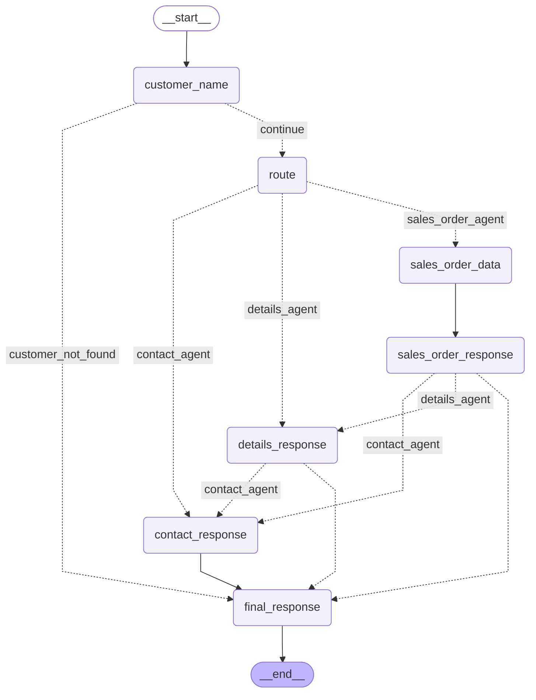

# AI ERPNext Business Assistant

An AI-powered business assistant that connects with ERPNext to answer customer-related questions and retrieve sales order information using LLMs, LangGraph workflows, and specialized agents.

The project explores how to build reliable AI applications through structured workflows, reflection, iterative feedback, multi-agent routing, and ERPNext API integration.

## Overview

The AI ERPNext Business Assistant supports customer and sales order queries through a conversational interface.

The project has evolved through three stages:

- **Reflection:** Analyzes retrieved sales order data and reviews the generated answer.
- **Reflexion:** Uses feedback and lessons from previous attempts to improve an answer through an iterative workflow.
- **Multi-Agent System:** Routes user requests to specialized agents for customer details, contact information, or sales order queries with support for combined requests.

The application uses ERPNext as its business data source and a locally running LLM for language processing.

## Latest PR Update (summary)

Key improvements focused on routing reliability, status validation, UI streaming, and clear error propagation for sales-order handling. These changes preserve existing agent routing logic while im[...]

## Application Demo

The screenshot below shows the application running in Gradio.


The Gradio UI supports progressive rendering of workflow execution: node-level progress and partial node outputs are streamed to the interface so users can observe incremental results while the gr[...]

## Features

- **Customer Details:** Retrieve customer information, including customer type and customer group.
- **Customer Contact:** Retrieve customer contact information, including phone number and email address.
- **Sales Order Retrieval:** Fetch customer sales orders with optional status filtering.
- **Multi-Agent Workflow:** Route user queries to the appropriate agent based on the request.
- **Combined Queries:** Support requests that combine customer details, contact information, and sales orders.
- **Conditional Routing:** Execute only required agents based on detected intent.
- **Structured Responses:** Format customer information and sales-order results for readability.
- **Missing-data & API error handling:** Clear handling when fields are unavailable or ERPNext returns errors.

## Example Queries

**Customer details**

- "Show me Sandeep's customer group."
- "Show me Sandeep's customer details."

**Contact information**

- "Show me Sandeep's mobile number."
- "Show me Sandeep's email address."

**Sales orders**

- "Show me Sandeep's sales orders."
- "Show me Sandeep's Draft sales orders."
- "Show me Sandeep's Completed sales orders."

**Combined queries**

- "Show me Sandeep's customer group and sales orders."
- "Show me Sandeep's mobile number and sales orders."
- "Show me Sandeep's customer group, mobile number, and sales orders."

## Architecture

The project uses different LangGraph workflows to demonstrate increasingly capable AI application patterns.

### 1. Reflection Workflow

The Reflection workflow retrieves sales orders for a customer, analyzes the results, and reviews the generated analysis.

Main flow:
1. Retrieve sales orders from ERPNext.
2. Analyze the retrieved data.
3. Review the generated analysis.
4. Return the response.

The goal is to check the quality and completeness of an answer before returning it.

### 2. Reflexion Workflow

The Reflexion workflow extends Reflection by introducing feedback, lessons, and retries.

Main flow:
1. Retrieve sales order data.
2. Generate an analysis.
3. Evaluate the analysis.
4. If improvements are required, generate feedback.
5. Extract a lesson from the previous attempt.
6. Retry the analysis using the available feedback and previous-attempt information.
7. Stop when the response is approved or the maximum iteration limit is reached.

This workflow demonstrates how a graph can use state, conditional edges, and iterative execution to improve an answer.

### 3. Multi-Agent Workflow

The Multi-Agent workflow routes user requests to the appropriate processing path and supports combined queries that execute multiple agents in sequence. The diagram below is the exact Mermaid flo[...]



#### Multi-Agent Workflow Steps

1. **Customer Name Extraction:** Extract the customer name from the user's query.
2. **Supervisor Routing:** Identify the requested information and select the appropriate route(s). The supervisor selects among `details_agent`, `contact_agent`, and `sales_order_agent`. Combined[...]
3. **Agent Execution:**
   - Customer Details Agent retrieves customer details.
   - Customer Contact Agent retrieves contact information.
   - Sales Order Agent retrieves and formats sales orders.
4. **Conditional Routing:** For combined queries, agents can indicate follow-on agents to execute (for example, after retrieving sales orders, the graph may route to the details or contact agents[...]
5. **Final Response:** Combine the requested information into one response.

The workflow supports individual requests and combined requests for customer details, contact information, and sales orders.

#### Workflow Components

| Component | Responsibility |
|---|---|
| `customer_name` | Identifies the customer referenced in the user's query. |
| `route` | Determines which processing path should handle the request. |
| `details_response` | Retrieves and prepares customer details. |
| `contact_response` | Retrieves and prepares customer contact information. |
| `sales_order_data` | Retrieves sales order data from ERPNext. |
| `sales_order_response` | Processes the retrieved sales order information into a response. |
| `final_response` | Produces the final response for the selected processing path. |

## Specialized Agents

### Customer Supervisor Agent

The supervisor interprets the user's query and determines which customer-related processing path is appropriate. It supports routing for all supported combinations of details, contact, and sales [...]

### Customer Details Agent

Handles customer information retrieved from ERPNext, such as:
- Customer name
- Customer group
- Territory
- Customer type

Unavailable fields are represented clearly rather than being treated as populated values.

### Customer Contact Agent

Handles customer contact information, including:
- Mobile number
- Email address

### Sales Order Agent

Retrieves sales orders for a specified customer and supports filtering by sales order status.

Supported status filters include:
- Draft
- To Deliver
- To Deliver and Bill
- To Bill
- Completed
- Cancelled
- Closed

If the user does not specify a status, the agent retrieves the customer's sales orders without applying a status filter.

The agent separates status extraction from ERPNext data retrieval so that the requested status can be used when fetching the relevant orders.

## ERPNext Integration

The application uses ERPNext REST APIs to retrieve business data.

The integration is organized into service modules for different resources, including:
- Customers
- Contacts
- Sales orders

This separation keeps ERPNext API calls outside the agent's language-processing logic and makes the application easier to test and maintain.

## State Management and Routing

LangGraph manages workflow execution and passes information between nodes through shared state.

The Multi-Agent workflow uses routing decisions to select the appropriate processing path. Retrieved data is passed through the graph to the response-generation nodes.

This structure helps separate:
- User query interpretation
- Routing decisions
- ERPNext data retrieval
- Response preparation
- Final response generation

## Testing

### Automated Tests

Run the test suite with:

```bash
python -m pytest
```

Automated tests referenced in the repository:
- tests/test_analyzer.py
- tests/test_reflexion_debug.py

Keep manual multi-agent validation separate from automated test results.

### Manual Multi-Agent Validation

Manually verify the seven routing combinations and additional reliability scenarios:
- Customer details
- Contact information
- Sales orders
- Customer details and contact information
- Customer details and sales orders
- Contact information and sales orders
- Customer details, contact information, and sales orders

Only keep manual-validation claims for scenarios that were actually tested.

## LangSmith Observability

LangSmith is used for tracing and inspecting LangChain/LangGraph execution. Tracing helps inspect node execution, LLM calls, intermediate outputs, workflow errors, and the flow of information bet[...]

## Technology Stack

| Technology | Purpose |
|---|---|
| Python | Application logic |
| ERPNext REST API | Business data retrieval |
| FastAPI | API development |
| LangChain | LLM integration and prompt management |
| LangGraph | Stateful workflows and conditional routing |
| Ollama | Local LLM execution |
| Qwen2.5 3B | Local language model |
| Gradio | Interactive application interface |
| LangSmith | Tracing and observability |
| Git and GitHub | Version control and project hosting |

## Project Structure

```text
.
├── README.md
├── __init__.py
├── app
│   ├── __init__.py
│   ├── agents
│   │   ├── __init__.py
│   │   ├── analyzer.py
│   │   ├── customer_contact_agent.py
│   │   ├── customer_details_agent.py
│   │   ├── customer_supervisor.py
│   │   ├── feedback.py
│   │   ├── lesson.py
│   │   ├── reflector.py
│   │   └── sales_order_agent.py
│   ├── api
│   │   ├── __init__.py
│   │   └── routes.py
│   ├── erpnext
│   │   ├── __init__.py
│   │   ├── client.py
│   │   ├── contact.py
│   │   ├── customer.py
│   │   └── sales_order.py
│   ├── gradio_app.py
│   ├── graph
│   │   ├── __init__.py
│   │   ├── edges.py
│   │   ├── nodes.py
│   │   ├── prompts.py
│   │   ├── state.py
│   │   ├── workflow.py
│   │   └── workflow_multi.py
│   └── multi_agent_gradio_app.py
├── data
│   ├── api_all_keys.json
│   ├── config.py
│   └── item.py
├── debug
│   ├── debug_graph.py
│   ├── flow_graph.txt
│   ├── reflexion_debug.txt
│   ├── state_debug.txt
│   └── test.py
├── main.py
├── note.txt
├── pytest.ini
├── requirements.txt
└── tests
    ├── reflexion_debug.txt
    ├── test_analyzer.py
    ├── test_client.py
    ├── test_contact.py
    ├── test_contact_agent.py
    ├── test_customer.py
    ├── test_customer_agent.py
    ├── test_edges.py
    ├── test_erpnext_client.py
    ├── test_nodes.py
    ├── test_reflector.py
    ├── test_reflexion_debug.py
    ├── test_sales_order.py
    ├── test_sales_order_agent.py
    ├── test_supervisor.py
    └── test_workflow.py
```

*Note: This mirrors the repository structure; adjust only if file locations change in future PRs.*

## Prerequisites

Before running the application, ensure you have:
- Python 3.12 or a compatible version.
- Access to a running ERPNext instance.
- An ERPNext API key and API secret with the necessary read permissions.
- Ollama installed with the `qwen2.5:3b` model available locally.

Install Ollama from https://ollama.com/ and download the model:

```bash
ollama pull qwen2.5:3b
```

## Installation

1. Clone the repository

```bash
git clone https://github.com/pardeepai/ai-erpnext-assistant.git
cd ai-erpnext-assistant
```

2. Create and activate a virtual environment (example for Linux/WSL):

```bash
python3 -m venv .venv
source .venv/bin/activate
```

3. Install dependencies:

```bash
pip install -r requirements.txt
```

4. Configure environment variables

Create a `.env` file in the project root. Minimum required variables:

```env
ERPNEXT_URL=http://127.0.0.1:8000
ERPNEXT_API_KEY=your_api_key
ERPNEXT_API_SECRET=your_api_secret
```

Optional variables for the local LLM and tracing:

```env
# Ollama / local model (if used)
OLLAMA_URL=http://127.0.0.1:11434
MODEL_NAME=qwen2.5:3b

# LangSmith tracing (optional)
LANGSMITH_TRACING=true
LANGSMITH_API_KEY=your_langsmith_api_key
LANGSMITH_PROJECT=ai-erpnext-assistant
```

Security: never commit `.env` or expose API credentials in source code, screenshots, logs, or public repositories. Ensure `.env` is included in `.gitignore`.

## Running the Application

Start Ollama and confirm that the model is available:

```bash
ollama list
```

Run the Gradio application from the project root:

```bash
python multi_agent_gradio_app.py
```

Open the local Gradio URL displayed in the terminal and enter a business query. If your Gradio entry point is located in a different file, use that path.

## Error Handling

The application includes clear handling for common ERPNext API failures:

| Scenario | Expected behavior |
|---|---|
| HTTP 401 | Reports an authentication failure. |
| HTTP 403 | Reports a permission-related failure. |
| Customer not found | Handles the missing customer without proceeding as though the customer exists. |
| No matching sales orders | Returns an appropriate empty-result response. |
| Invalid sales-order status | Rejects or safely handles unsupported status values. |
| API request failure | Uses the application's API error-handling path rather than treating the failure as valid business data. |

Error messages should communicate the problem without exposing API secrets.

## Design Principles

- Keep agent responsibilities focused and separate.
- Use LangGraph to manage routing and shared workflow state.
- Keep API credentials outside application source code.
- Handle missing data and API failures explicitly.
- Validate changes with tests before merging pull requests.
- Prefer small, maintainable changes over unnecessary complexity.

## Current Scope

The current focus is a reliable, understandable multi-agent ERPNext assistant. The project is intended as a learning and portfolio project demonstrating API integration, Python development, LangG[...]

It should not be considered production-ready without further deployment hardening, security review, broader automated coverage, and operational validation.

## Future Improvements

Potential improvements include:
- Additional API failure and edge-case tests
- Clearer separation of response-formatting helpers
- Improved documentation and troubleshooting guidance
- Retrieval-augmented generation (RAG) and evaluation in a subsequent milestone
