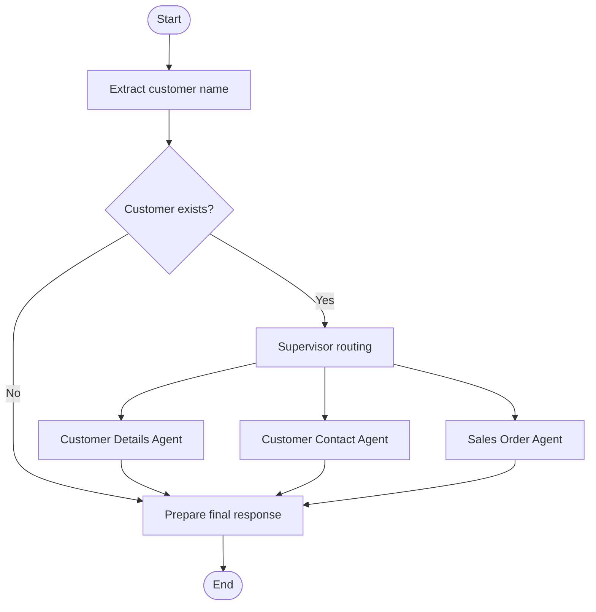

# AI ERPNext Business Assistant

An AI-powered assistant that connects to ERPNext and retrieves customer details, contact information, and sales orders through natural-language queries.

This project demonstrates practical AI application patterns using **Python, LangGraph, local LLMs, and ERPNext REST APIs**. It includes Reflection, Reflexion, and a supervisor-based Multi-Agent workflow.

## Project Overview

The project explores three approaches to building LLM-powered workflows:

- **Reflection:** Generates an analysis of sales order data and reviews the result.
- **Reflexion:** Uses feedback, lessons, and iterative attempts to improve an analysis.
- **Multi-Agent System:** Uses a supervisor to route queries to specialized agents that retrieve customer details, contact information, and sales orders.

The application uses Ollama to run a local language model and Gradio to provide an interactive interface with workflow progress updates.

## Key Features

- Natural-language queries for ERPNext customer and sales order data.
- Stateful workflows implemented with LangGraph.
- Reflection and Reflexion for iterative analysis.
- Supervisor-based routing to specialized agents.
- Support for individual and combined information requests.
- Customer verification before processing requests.
- Sales order status extraction and validation.
- Handling of missing customer and contact information.
- ERPNext API error handling, including authentication and permission errors.
- Streaming workflow progress in the Gradio interface.
- Optional LangSmith tracing for workflow observability.
- Automated tests using pytest.

## Technology Stack

| Technology | Purpose |
|---|---|
| Python | Application logic and integrations |
| LangGraph | Stateful workflows, shared state, and conditional routing |
| LangChain | LLM integration |
| Ollama | Local LLM execution |
| Qwen2.5 3B | Local language model |
| ERPNext REST API | Customer, contact, and sales order data |
| Gradio | Interactive interface and workflow progress |
| FastAPI | API application entry point |
| LangSmith | Workflow tracing and debugging, when configured |
| pytest | Automated testing |
| Git and GitHub | Version control |

## Architecture

### 1. Reflection Workflow

The Reflection workflow analyzes a customer's sales order data and reviews the generated analysis.

**Workflow:**

1. Retrieve sales orders from ERPNext.
2. Calculate relevant order counts.
3. Generate an analysis using the LLM.
4. Review the analysis.
5. Return the result.

This workflow demonstrates how an LLM-generated result can be reviewed before being returned.

### 2. Reflexion Workflow

The Reflexion workflow extends the analysis process with feedback and iterative improvement.

**Workflow:**

1. Retrieve sales order data.
2. Generate an initial analysis.
3. Evaluate the analysis.
4. Generate feedback when improvements are needed.
5. Extract a lesson from the previous attempt.
6. Retry using feedback and previous-attempt information.
7. Stop when the result is approved or the iteration limit is reached.

This workflow demonstrates shared state, conditional routing, feedback, and bounded iterative execution.

### 3. Multi-Agent Workflow

The Multi-Agent workflow interprets the user's query, verifies the customer, and routes the request to the appropriate processing path.

**Specialized agents:**

- **Customer Supervisor Agent:** Determines which information is requested and selects a route.
- **Customer Details Agent:** Retrieves available customer details.
- **Customer Contact Agent:** Retrieves available contact information.
- **Sales Order Agent:** Retrieves sales orders and supports status filtering.

**Supported request types:**

- Customer details
- Contact information
- Sales orders
- Customer details and contact information
- Customer details and sales orders
- Contact information and sales orders
- Customer details, contact information, and sales orders

#### Multi-Agent workflow diagram



The workflow uses shared state to pass the query, customer information, routing decisions, retrieved data, error information, and responses between nodes.

## Example Queries

The following examples illustrate the kinds of requests supported by the application:

- "Show me Sandeep's customer details."
- "Get Sandeep's contact information."
- "Show me Sandeep's sales orders."
- "Show me Sandeep's completed sales orders."
- "Show me Sandeep's customer details and contact information."
- "Show me Sandeep's customer details and sales orders."
- "Show me Sandeep's contact information and sales orders."
- "Show me all information for Sandeep."

The results depend on the customer records and data available in the connected ERPNext instance.

## ERPNext Integration and Error Handling

The application uses ERPNext REST APIs to retrieve customer, contact, and sales order information.

The ERPNext client centralizes API communication and loads configuration from environment variables.

Create a local `.env` file in the project root:

```env
ERPNEXT_URL=your_erpnext_url
ERPNEXT_API_KEY=your_api_key
ERPNEXT_API_SECRET=your_api_secret
```

Replace the example values with credentials for your ERPNext instance.

**Security notes:**

- Never commit `.env` or real API credentials to GitHub.
- Use an ERPNext API account with only the permissions required by the application.
- Do not expose API credentials in screenshots, logs, or example outputs.

The workflow includes handling for relevant scenarios such as:

- Authentication failures
- Permission errors
- Customers that cannot be found
- Missing contact information
- Empty sales order results
- Unsupported sales order status requests

A successful API request with no matching records should be distinguished from a failed API request.

## Local Setup

### Prerequisites

Install the following before running the application:

- Python
- [Ollama](https://ollama.com/)
- Access to an ERPNext instance with the required API permissions

### 1. Clone the repository

```bash
git clone https://github.com/pardeepai/ai-erpnext-assistant.git
cd ai-erpnext-assistant
```

### 2. Create and activate a virtual environment

```bash
python -m venv .venv
```

On Windows:

```bash
.venv\Scripts\activate
```

On Linux or macOS:

```bash
source .venv/bin/activate
```

### 3. Install dependencies

```bash
python -m pip install -r requirements.txt
```

The current `requirements.txt` does not include every optional interface and observability dependency. For the Gradio interface, install Gradio if it is not already installed:

```bash
python -m pip install gradio
```

Install LangSmith if you want to use its tracing features:

```bash
python -m pip install langsmith
```

### 4. Prepare the local language model

Start Ollama and download the model used by the project:

```bash
ollama pull qwen2.5:3b
```

Make sure Ollama is running before submitting requests through the application.

### 5. Configure ERPNext

Create the `.env` file described in the ERPNext Integration section and add your ERPNext URL and API credentials.

### 6. Run the application

Launch the Multi-Agent interface from the project root:

```bash
python -m app.multi_agent_gradio_app
```

To launch the Reflection/Reflexion interface:

```bash
python -m app.gradio_app
```

Follow the local URL printed in the terminal to open the Gradio interface.

## Testing

Run the automated tests from the project root:

```bash
python -m pytest
```

To see individual test names and results:

```bash
python -m pytest -v
```

The repository includes tests for workflow components and ERPNext-related behavior. The exact number of passing tests depends on the current code and test environment, so run the suite to verify the current state before reporting test results.

Manual validation of the Multi-Agent workflow should also cover:

- Existing and unknown customers
- Customers with missing contact information
- Individual and combined information requests
- Valid and unsupported sales order statuses
- Empty sales order results
- ERPNext authentication and permission failures

Manual checks and automated pytest results should be reported separately.

## Project Structure

```text
ai-erpnext-assistant/
├── app/
│   ├── agents/
│   │   ├── analyzer.py
│   │   ├── reflector.py
│   │   ├── feedback.py
│   │   ├── lesson.py
│   │   ├── customer_supervisor.py
│   │   ├── customer_details_agent.py
│   │   ├── customer_contact_agent.py
│   │   └── sales_order_agent.py
│   ├── api/
│   │   └── routes.py
│   ├── erpnext/
│   │   ├── client.py
│   │   ├── customer.py
│   │   ├── contact.py
│   │   └── sales_order.py
│   ├── graph/
│   │   ├── edges.py
│   │   ├── nodes.py
│   │   ├── prompts.py
│   │   ├── state.py
│   │   ├── workflow.py
│   │   └── workflow_multi.py
│   ├── gradio_app.py
│   └── multi_agent_gradio_app.py
├── data/
├── tests/
├── main.py
├── pytest.ini
├── requirements.txt
├── .gitignore
└── README.md
```

This is a high-level view of the project. Refer to the repository for the complete and current file list.

## Application Screenshots

Screenshots of the existing interface and workflow executions are included below.

### 1. Application Interface


### 2. Reflection Workflow


### 3. Reflexion Workflow


### 4. Multi-Agent Workflow


### 5. Sales Order Results and Error Handling


## Project Goal

The goal of this project is to demonstrate practical implementation of:

- Stateful LLM workflows with LangGraph
- Reflection and Reflexion patterns
- Supervisor-based Multi-Agent routing
- Integration with ERPNext REST APIs
- Error handling for external API interactions
- Local LLM execution using Ollama
- Workflow progress streaming and observability
- Testing and debugging of an AI application

This is a learning and portfolio project focused on demonstrating implementation decisions, workflow behavior, and reliability considerations. It is not presented as a fully production-ready enterprise system.
